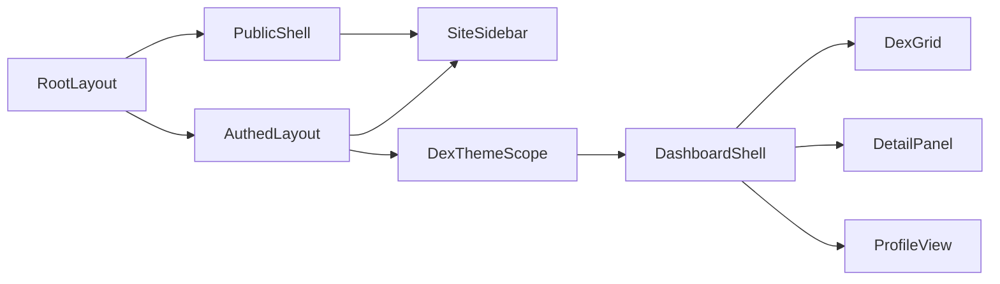

# Bobadex authenticated web UI redesign plan

Restyles the signed-in Bobadex web routes (`/dashboard`, `/dashboard/[shopId]`, and a new frontend-only `/dashboard/profile`) in the Flutter app's visual language: warm paper, Fraunces and Inter, flat outlined cards, square dex tiles, and a drink ledger. The site sidebar becomes the single navigation, desktop gets a list-and-detail layout, and data, auth, and public pages stay unchanged.

Source of truth for facts: [AUTH_WEB_UI_CONTEXT.md](AUTH_WEB_UI_CONTEXT.md) and [mobile-ui-handoff.md](mobile-ui-handoff.md). Flutter reference: `bobadex-app/lib/ui/theme/` and `bobadex-app/lib/ui/components/`.

Decisions already made:

- Profile becomes a real frontend-only page at `/dashboard/profile`. It uses only data the web already reads.
- Sign-out is added. It calls the existing Supabase client `signOut()`.
- All ten drink themes ship as scoped CSS tokens. Classic Milk Tea is fixed as the default, and wiring the account theme is future work.

## 1. Visual direction and principles

The look is the Flutter "collector's ledger": warm paper, one accent, flat outlined cards, serif headlines, and gold stars. Desktop gets more columns and a list-and-detail layout instead of stretched phone screens.

- **One family, two grounds.** Public catalogue pages stay on site paper (`#fbf8f0` / `#2b241f`). The personal dex uses Classic Milk Tea (`#F5EEE3` / `#2B1F17`, surface `#FFFCF7`, outline `#E3D6C5`, accent `#8A5A3C`). The two grounds are the same family, and the handoff keeps account themes off public pages.
- **Type does the branding.** Fraunces 600 for titles and numerals, Inter for body and controls. This applies inside the authenticated scope only, so public pages stay on Geist.
- **Flat over decorated.** Cards use a 1px outline and no shadow. The floating shadow is reserved for hover and the sticky detail panel. Corner radii follow the Flutter tokens (6 / 10 / 14 / 20 / 28 / pill).
- **The mascot is the hero of each tile.** `BrandMark` stays the single mark component, and the device Mascots/Minimal setting keeps working everywhere.
- **Honest states.** Show "Unrated", not an em dash. Every loading, empty, and error state is designed, and no counts are invented.
- **Vocabulary from the handoff.** Say "Your brands" and "your drinks", not "shops", in user-facing copy. Code names stay as they are.

## 2. Navigation and layout structure

There is one shell for the whole site. The authenticated area drops the placeholder `TopNav` and reuses the site sidebar ([PublicSidebar.tsx](../src/shared/layout/PublicSidebar.tsx)), so signed-in users see one consistent navigation on every route.

- **[`(authed)/layout.tsx`](<../src/app/(authed)/layout.tsx>).** Remove `TopNav`. Render `PublicSidebar`, then a content column offset `md:ml-52`, mirroring [PublicShell.tsx](../src/shared/layout/PublicShell.tsx). Wrap the content in the dex theme scope (`data-boba-theme="classic_milk_tea"`, `bg-boba-bg text-boba-ink`, Inter and Fraunces font variables). Do not show the auth-off banner here, because authenticated routes are unreachable while auth is off.
- **Delete [TopNav.tsx](../src/shared/layout/TopNav.tsx).** It is only used in the authenticated layout.
- **The sidebar keeps site paper on every route.** It does not take the dex theme. This keeps navigation identical across public and authenticated pages and avoids tokenizing `UserMark` now.
- **Sidebar changes (shared file, isolated):**
  - Member links (My Bobadex, Profile) get the same active style as catalogue links. Today they never show active.
  - Active matching is fixed so that `/dashboard/profile` highlights Profile only and `/dashboard/*` highlights My Bobadex.
  - Signed in: a "Sign out" item sits in the slot "Sign in" uses today (`md:mt-auto`). Guests see no change.
  - Optional: small eyebrow labels "Catalogue" and "Your Bobadex" above the two link groups, at `md` and up only.
- **[DashboardShell.tsx](../src/features/dashboard/components/DashboardShell.tsx)** keeps owning the `["shops", ownerId]` query and the brands map. It chooses one of three layouts using `useSelectedLayoutSegment()`:
  - **`/dashboard`:** dex header plus a full-width grid.
  - **`/dashboard/[shopId]`:** grid plus a sticky detail panel from `lg`. Below `lg`, the detail takes the full page.
  - **`/dashboard/profile`:** the profile view at full width, with no grid.
- **Profile routing.** `/dashboard/profile` becomes a static route that takes precedence over `[shopId]`. This needs no change to the authentication check in [`dashboard/layout.tsx`](<../src/app/(authed)/dashboard/layout.tsx>).
- **Page scrolling.** The page scrolls normally. The fixed 65/35 grid with inner scroll boxes is removed.

## 3. Screen-by-screen recommendations

### Dex home: `/dashboard`

Files: [DashboardShell.tsx](../src/features/dashboard/components/DashboardShell.tsx), [ShopsView.tsx](../src/features/shops/components/ShopsView.tsx), [`dashboard/page.tsx`](<../src/app/(authed)/dashboard/page.tsx>).

- **Header (`DexHeader`).** An eyebrow "Your Bobadex", then a Fraunces title (32px, 40px at `lg`), then "N brands" in Inter 14 `inkMuted`. Drink totals are omitted because no drink count is loaded.
- **Toolbar (client-side only, over shops already loaded).**
  - Search by name.
  - Sort chips: Favorites, Rating, Name, Added. These use `is_favorite`, `rating`, `name`, and `created_at`, which the existing `select("*")` already returns.
  - Chips are pills: off is `surfaceAlt`/`inkMuted`, on is `accentSoft`/`accentInk`.
  - The toolbar is hidden when the user has 5 or fewer brands.
- **Tiles (`DexTile`, which replaces the tile markup in `ShopsView`).**
  - Shape and surface: square (`aspect-square`), `surface` background, 1px `outline`, 20px radius, 12px padding, and a 3px left spine in `accentInk`.
  - Content: name in Fraunces 15, clamped to 2 lines. Footer shows a gold star with the rating to one decimal, or "Unrated". When `is_favorite` is set, a heart in the `heart` color sits top-right. `BrandMark` sits bottom-right at about 55% of tile width.
  - States: hover lifts the tile (`-translate-y-0.5`) and adds the floating shadow, press scales it to 0.98, and the active tile gets a 2px `accent` ring.
  - Each tile stays a `Link` to `/dashboard/{id}`.
- **Grid.** `grid-cols-2` on mobile, then `repeat(auto-fill,minmax(176px,1fr))` from `md`, with an 8px gap on mobile and 12px from `md`.
- **States.**
  - Loading: a skeleton grid of 8 tiles.
  - Error: an inline `EmptyState` reading "Couldn't load your dex." in the `danger` color, replacing `text-red-500`.
  - Empty: an `EmptyState` titled "Your dex is empty.", with body text pointing to the mobile app and a link to `/brands`.
- **Panel placeholder.** `dashboard/page.tsx` renders nothing on desktop. "Select a shop." is replaced by the layout itself: no panel until a brand is chosen.

### Brand detail: `/dashboard/[shopId]`

File: [ShopDetails.tsx](../src/features/shops/components/ShopDetails.tsx).

- **Panel container.** From `lg`: a 380px panel (420px at `xl`) on `surface`, 28px radius, 1px outline, floating shadow, `sticky top-6`, and `max-h-[calc(100vh-3rem)]` with internal scroll. It has a close control linking to `/dashboard`. Below `lg`: the grid is hidden and the detail renders full width with a "Back to your dex" link.
- **Header band.** `accentSoft` background, 20px top radius, `BrandMark` at 96px. Shop name in Fraunces 24, then a rating row (star plus Fraunces numeral, or "Unrated") and a heart if favorited. Add a "View brand" link to `/brands/{brand_slug}` when the slug exists; that public route already exists.
- **Shop notes.** Shown when `shop.notes` is set: Inter 14 `inkMuted`, clamped to 3 lines, expandable.
- **Pinned drink.** If `pinned_drink_id` matches a loaded drink, show it first with a bookmark in the `heart` color.
- **Drinks ledger.**
  - A "Drinks" heading in Fraunces 18 with a count.
  - `DrinkRow` entries with no card and hairline dividers. Each row has a 52px rating column (Fraunces numeral and a small star, or "—" in `inkFaint`), the name in Inter 13/600, and notes in `inkMuted` clamped to 2 lines.
  - The row is a `button` with `aria-expanded` that expands the notes. A heart shows on favorites.
  - Optional: a lock icon with `title="Private"` when `visibility === "private"`.
- **Client-side search and sort** appear only when there are more than 5 drinks, following the handoff.
- **States.**
  - Loading: 4 skeleton rows.
  - Empty: "No drinks logged yet."
  - Error: "Couldn't load drinks." The `error` value from `useQuery` is already returned but never rendered today.
  - Shop not in cache: a skeleton while the shops query is fetching, then "This brand isn't in your dex." with a link to `/dashboard`.

### Profile: `/dashboard/profile` (new frontend-only route)

New file `src/app/(authed)/dashboard/profile/page.tsx`, plus `src/features/profile/ProfileView.tsx`.

- **`CollectorCard`.**
  - Container: 28px radius, `surface`, 1px outline.
  - Top band: 72px, `accentSoft`, with a spaced "BOBADEX" eyebrow.
  - Identity: `UserMark` at 88px with a 3px `surface` ring overlapping the band, display name in Fraunces 24, and `@username` in `inkMuted`.
- **Data.**
  - The users row comes from the exact `select("username, display_name, profile_image_path")` the sidebar already runs.
  - Stats come from the cached `["shops", ownerId]` data: Brands (count), Favorites (count of `is_favorite`), and "Collecting since" (earliest `created_at`). Stats render on `surfaceAlt` tiles with a 14px radius.
- **Below the card, a list of rows:**
  - "Brand visuals" links to `/settings`.
  - "Rankings" links to `/rankings`.
  - "About" links to `/about`.
  - "Sign out" uses the outlined `danger` style.
- **Missing pieces are left out, not stubbed.** Drinks and badges stats, the badge slots, the leaderboard preview, bio, and editing are all listed in section 9.

### Signed-in slices of public pages (minimal, isolated)

- [SettingsView.tsx](../src/features/settings/SettingsView.tsx): "Open profile" now works with no change. Optionally add `SignOutButton` to the signed-in account block.
- [BrandVisitClient.tsx](../src/features/brands/BrandVisitClient.tsx): rename "Edit in your dex" to "Open in your dex", because the web cannot edit. Keep the existing public styling.
- Auth forms, home, brands, rankings, and achievements: no change.

## 4. Shared components and design tokens

**Tokens** go in [globals.css](../src/app/globals.css) as CSS variables scoped by `[data-boba-theme]`, exposed through Tailwind v4 `@theme inline`. Use the `boba-` prefix so they don't collide with the shadcn `accent`, `muted`, and similar tokens.

- **Color tokens:**
  - From the theme table: `--boba-bg`, `surface`, `surface-alt`, `outline`, `ink`, `ink-muted`, `ink-faint`, `accent`, `on-accent`, `accent-soft`, `accent-ink`.
  - Shared semantics: `star`, `star-outline`, `heart`, `success`, `danger`, `shadow`.
  - Utilities follow the same names, for example `bg-boba-surface`, `text-boba-ink-muted`, and `border-boba-outline`.
- **Themes.** `[data-boba-theme="<slug>"]` blocks for all ten slugs, with values copied verbatim from `boba_themes.dart`. The three dark themes carry their own semantics: star `#F0C25A`, `onAccent` equal to that theme's `bg`, and so on. The base `[data-boba-theme]` selector defaults to Classic Milk Tea.
- **Fonts.** `--font-display` maps to the Fraunces variable and `--font-body` to the Inter variable. Load both with `next/font/google` in `(authed)/layout.tsx`, not the root layout, so public pages don't preload them.
- **Radius, shadow, and motion tokens:**
  - Radii: `--radius-boba-xs` through `--radius-boba-xl` (6 / 10 / 14 / 20 / 28).
  - Shadow: `--shadow-boba-floating` is `0 8px 24px` in the theme's `shadow` color.
  - Motion: durations of 120 ms for press, 180 ms fast, and 260 ms normal. All motion is wrapped in `motion-safe:`.
- **shadcn bridge.** Inside the scope, remap the shadcn variables (`--background`, `--border`, `--muted`, `--ring`, and so on) to `boba` values. Any later use of `src/shared/ui/skeleton.tsx` or `button.tsx` then inherits the theme. Do not adopt the shadcn set broadly.
- **Constant.** A `DEFAULT_DEX_THEME = "classic_milk_tea"` constant lives in `src/features/dex/theme.ts`. It is the single place where account wiring will plug in later.
- **Isolation.** Leave `:root` and `.dark` untouched. Public hex classes are unchanged.

**New components.** These are small and local, with no new dependencies. Use `cn` from `src/lib/utils.ts` and `lucide-react` icons.

- `src/features/dex/components/`:
  - `DexHeader`
  - `DexTile`
  - `DexToolbar` (search plus `Chip`)
  - `DrinkRow`
  - `RatingValue` (star plus Fraunces tabular numeral, or "Unrated")
  - `EmptyState` (icon at 52px in `inkFaint`, max width 360px)
  - `SkeletonTile` / `SkeletonRow`
- `src/features/profile/`: `ProfileView`, `CollectorCard`, `StatTile`.
- `src/features/auth/components/SignOutButton.tsx`: calls the existing client `signOut()`, then `queryClient.clear()`, `router.replace("/")`, and `router.refresh()`.

**Reused unchanged:** `BrandMark`, `BrandLettering`, `UserMark`, `useBrands`, `fetchShopsByOwnerId`, and `fetchDrinksByShopId`.

## 5. Responsive behavior

- **Mobile web, below `md` (768px).**
  - Navigation: the sidebar keeps today's horizontal top bar.
  - Dex: two-column square grid, matching the phone default, with 16px page padding.
  - Detail: full page with a back link.
  - Toolbar: scrolls horizontally.
  - Profile: single column.
- **Tablet, `md` to `lg` (768–1023px).**
  - Navigation: fixed 208px sidebar.
  - Dex: auto-fill grid, about 3 columns.
  - Detail: full page with a back link.
  - Profile: card and list stacked, with the content capped at `max-w-2xl`.
- **Desktop, `lg` and up (1024px+).**
  - Dex: grid plus a sticky detail panel when a brand is selected. With no selection, the grid takes the full width (4–6 columns).
  - Profile: two columns, with the card on the left (360px) and the list on the right.
  - Content max width: `max-w-7xl`.
- **All sizes:**
  - Tap targets are at least 44px.
  - Focus-visible rings use `accent` at 2px.
  - Hover lift and press scale are disabled under `prefers-reduced-motion`.

## 6. Functionality and contracts that must stay intact

- **No changes to:**
  - `src/middleware.ts` or `utils/supabase/middleware.ts`.
  - The `getUser()` redirect in `dashboard/layout.tsx`.
  - The `AUTH_ENABLED` gating or the auth-off copy.
  - `EmailOtpForm` flows or its error sentences.
- **Data loading is unchanged:**
  - Query keys `["shops", ownerId]`, `["drinks", shopId]`, `["brand-visit", slug]`, and the brands cache.
  - Fetch functions and their selects, and the React Query defaults.
  - No new tables or columns are read. The only "new" read is the sidebar's existing users select, reused on the profile page.
- **Tile behavior:** tiles link to `/dashboard/{id}`, and the active state comes from the `shopId` route param.
- **Brand visuals:** the Mascots/Minimal device cookie and localStorage still drive `BrandMark` on every page.
- **Guest sidebar:** locked member links, the "Sign in" link to `/auth/login?next=/dashboard`, and the avatar link.
- **Public pages** render pixel-identical, except for:
  - the sidebar's active states for member links and the sign-out slot, which only signed-in users see;
  - the "Open in your dex" copy;
  - the optional sidebar group labels.
- **Settings** sections, radios, the AI & Data block, and the account-block copy.

## 7. Implementation phases

1. **Foundations (no visible change).** Add the `boba` tokens, all ten theme blocks, and the font utilities to `globals.css`. Add the `DEFAULT_DEX_THEME` constant. Verify public pages look identical.
2. **Shell and navigation.**
   - Rewrite `(authed)/layout.tsx` to use the sidebar and the theme scope, and delete `TopNav`.
   - Update sidebar active states and the sign-out slot.
   - Add `SignOutButton`.
   - Restructure `DashboardShell` by route segment and remove the 65/35 split.
3. **Dex grid.** Build `DexHeader`, `DexTile`, the skeleton, `EmptyState`, and the error state, and refactor `ShopsView` to use `DexTile`. Add the list-and-detail responsive behavior.
4. **Brand detail panel.** Restyle `ShopDetails`: header band, notes, pinned drink, `DrinkRow` ledger, states, and the cache-miss fallback.
5. **Profile.** Add the `/dashboard/profile` route, `ProfileView`, `CollectorCard`, and the links list.
6. **Polish (optional, each item independent).**
   - Client-side toolbar for the grid and the drinks list.
   - Dex-only lettering palette: a `BrandLettering` variant using the Flutter `brand_mark.dart` pairs. Public pages keep `brandAccent.ts`, so weigh this against consistency with the catalogue.
   - "Open in your dex" copy.
   - Sign-out on Settings.
   - Dark-theme QA via devtools attribute swap.

## 8. Acceptance criteria and visual checks

- **No auth or data regressions.** `/dashboard` and `/dashboard/[id]` load the same data as before. React Query devtools show the same keys and no extra requests besides the profile's users read.
- **No authenticated route shows white or neutral gray.** Ground is `#F5EEE3`, cards `#FFFCF7`, and borders `#E3D6C5`.
- **Fonts.** Every authenticated heading and numeral is Fraunces 600, body and controls are Inter, and no Geist is used inside the scope. Public pages still use Geist.
- **Public pages unchanged.** Before-and-after screenshots of `/`, `/brands`, `/brands/[slug]`, `/rankings`, `/achievements`, `/settings`, and `/auth/login` match apart from the listed sidebar and copy items.
- **Side-by-side with the phone:**
  - A dex tile next to the Flutter `EntryTile` matches radius, spine, star color, mark placement, and heart.
  - The drink ledger next to `DrinkRow` matches its layout and colors.
  - The profile next to `CollectorCard` matches as well.
- **Ratings** always show a gold star with one decimal, or "Unrated". No raw em dash appears for a brand rating.
- **Every state is designed.** Loading, empty, error, and cache-miss states render in both the grid and the detail.
- **Responsive.** At 375, 768, 1024, 1280, and 1536px there is no horizontal scroll. The detail panel is sticky from `lg`, and below `lg` the detail is a full page with a working back link.
- **Navigation.**
  - Profile and My Bobadex highlight correctly.
  - The avatar and "Open profile" both land on a real profile page.
  - Sign-out returns to `/` and shows guest navigation.
  - Signing back in shows no stale data.
- **Accessibility.**
  - Keyboard: Tab reaches every tile, row, and chip, and the focus ring is visible.
  - Expanding a row toggles `aria-expanded`.
  - Contrast follows the Flutter test: ink on bg and surface is at least 7:1; `inkMuted` on surface, `onAccent` on accent, and `accentInk` on bg are at least 4.5:1. Check this with Classic Milk Tea plus one dark theme via an attribute swap.
- **Reduced motion.** With reduced motion enabled, tiles do not translate or scale.

## 9. Future recommendations (need backend or data changes, so out of scope)

- **Account preferences from `user_settings`:**
  - `theme_slug` sets `data-boba-theme`, plus a theme picker.
  - `grid_columns` controls compact three-column tiles.
  - `use_icons` controls banner photo tiles. This needs per-shop banner media without N+1 queries.
  - `use_mascots`: the account value wins over the cookie, and changes write back.
- **Counts:** per-brand drink counts (the cup count on tiles), a total drinks stat, a badges stat, and pinned badges on the collector card.
- **Profile content:** a leaderboard preview (top three on Most brands, plus the user's own rank), bio, and profile editing.
- **Editing:** add, edit, and delete brands and drinks, plus the "Add a brand" personal search.
- **Code cleanup:** remove the unused `searchParams.userId` and `isOwner` in `dashboard/layout.tsx`.
- **Design follow-up (frontend, separate pass):** consider moving public pages to Fraunces headings and unifying `#fbf8f0` with `#F5EEE3`, so the catalogue and dex share exact values.
